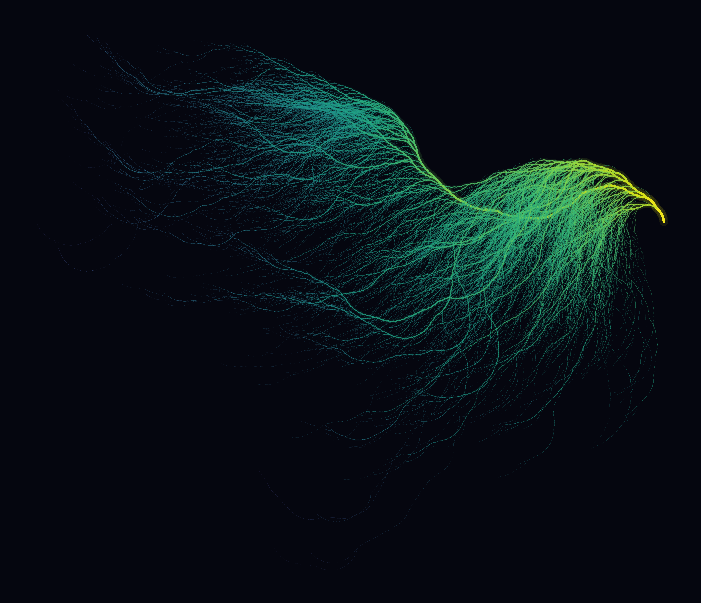
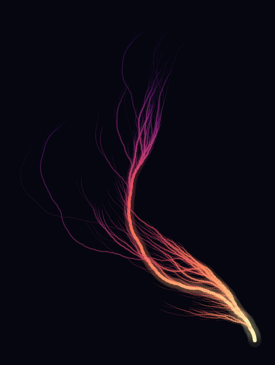
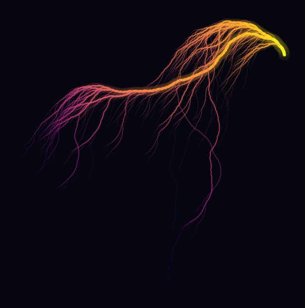
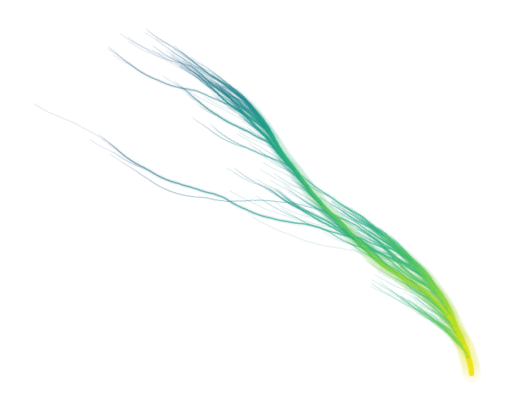

# Plume
A command-line Python tool that generates organic, coral-like visualizations of the Collatz conjecture by mapping sequences to branching angles.



## Requirements

```pip
matplotlib
numpy
pycairo
```

## Installation

Clone this repo and initialise the virtual environment - then install the requirements using pip. 

```bash
pip install -r requirements.txt
```

## Usage
You can run the script with default settings, which generates a high-resolution, magma-colored visualization for the first 10,000 integers:

```bash
python3 plume.py
```

### CLI arguments

| Argument | Short | Default     | Description |
| :--- | :--- |:------------| :--- |
| `--limit` | `-n` | `10000`     | Maximum starting integer to calculate sequences for. Higher numbers create denser "corals". |
| `--even-angle` | `-e` | `8.65`      | Turn angle in degrees when the sequence hits an even number. |
| `--odd-angle` | `-d` | `-16.0`     | Turn angle in degrees when the sequence hits an odd number. |
| `--output` | `-o` | `plume.png` | File path and name for the generated image. |
| `--dpi` | *None* | `300`       | Output image resolution (Dots Per Inch). |
| `--cmap` | `-c` | `magma`     | Matplotlib colormap used to shade the branches. |
| `--bg-color` | *None* | `#05060f`   | Background hex color. Defaults to a deep, dark blue/black. |
| `--size` | `-s` | `12.0`      | Width and height of the square output figure in inches. |
| `--quiet` | `-q` | `False`     | Flag to suppress progress output in the terminal. |


## Examples

| Style | Command                                                                                                                 | Output |
| :--- |:------------------------------------------------------------------------------------------------------------------------| :--- |
| **Mini Classic**| `python plume.py -n 2000 -s 4.0 --dpi 150 -o showcase_classic.png`                                                      |  |
| **Neon Web**| `python cplume.py -n 3000 -e 12.5 -d -20.0 -c plasma -s 4.0 --dpi 150 -o showcase_neon.png`                      |  |
| **Light Sketch**| `python plume.py -n 2500 -e 5.0 -d -8.0 -c viridis --bg-color "#FFFFFF" -s 4.0 --dpi 150 -o showcase_light.png` |  |